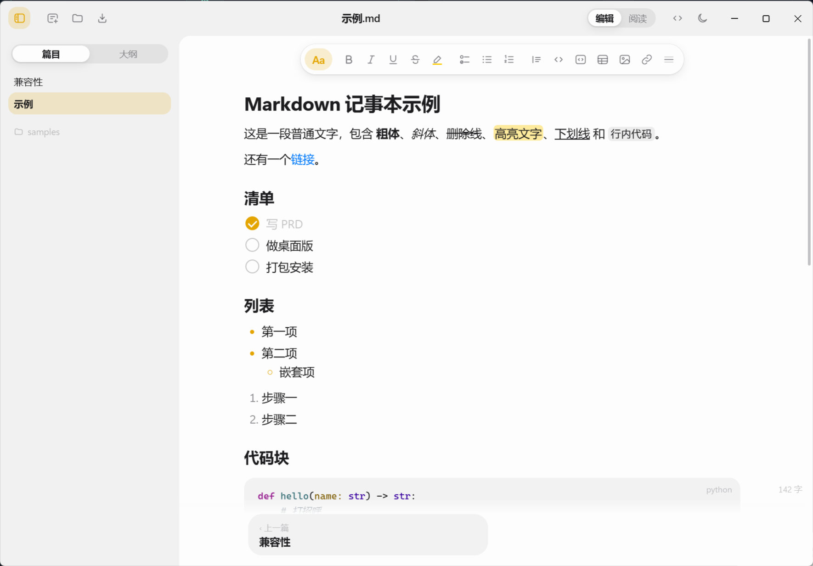
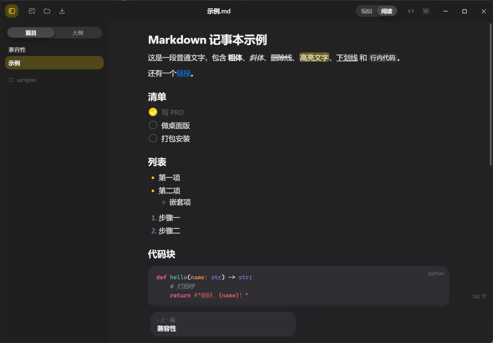
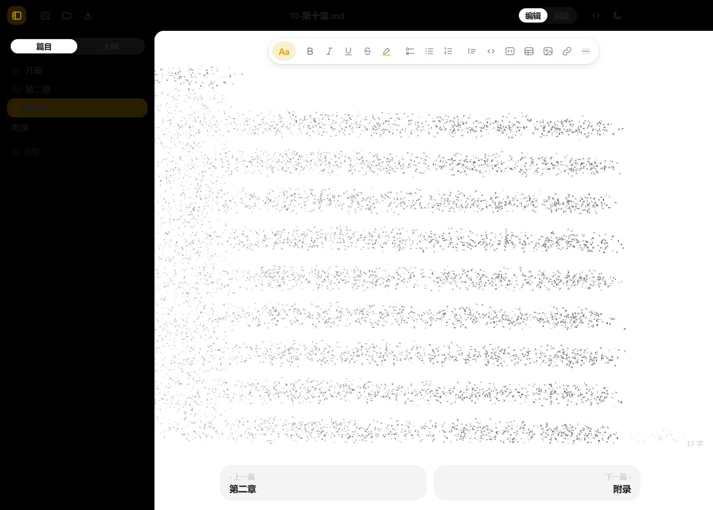
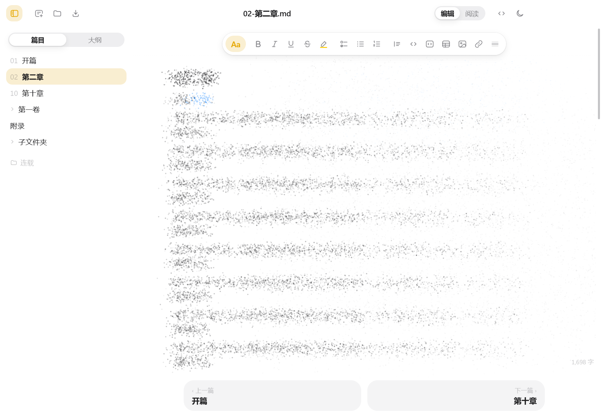
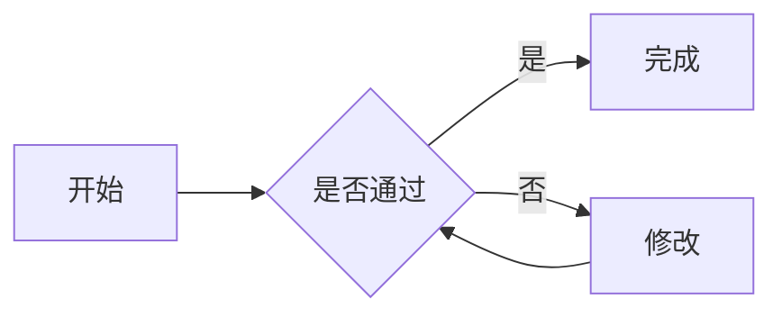
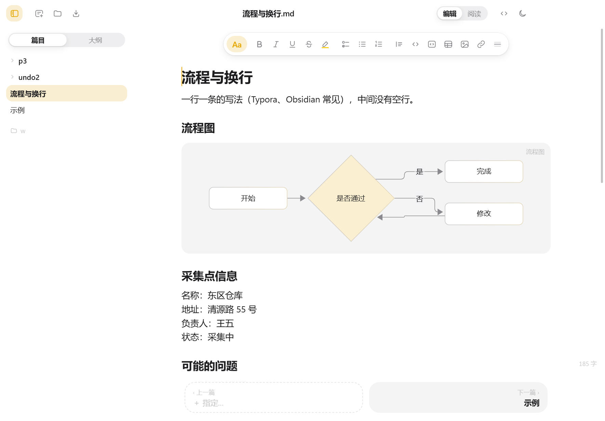

<p align="center">
  
</p>

<h1 align="center">Paperwind</h1>

<p align="center">
  最简洁好用的 Markdown 阅读器和编辑器（Windows 桌面版）<br>
  <b>不用记 Markdown 语法</b> · 所见即所得，点按钮就能排版 · 底层仍是标准 <code>.md</code> 文件
</p>

<p align="center">
  
</p>

---

## 它是什么

写 Markdown 的工具大多有点别扭：纯源码编辑器要记语法、看不到效果；左右分栏的预览占屏幕，写和看要来回扫；备忘录那种「点一下就加粗、加清单」的体验很顺手，但内容导不出来。

Paperwind 想把这几件事合在一起：

- **最简洁好用的阅读器**：打开就是排好版的样子，像读一篇文章，不用对着一堆 `#` 和 `*`；界面安静，只留内容。
- **不用记 Markdown 语法**：写的时候像备忘录，所见即所得，选中文字点一下就加粗、高亮、变成清单；会语法的话直接打 `## `、`- [ ] ` 也行。
- **底层仍是标准 Markdown**：保存的就是普通的 `.md` 文件，换回 Typora、Obsidian、VS Code、GitHub 都能正常显示。没改过的段落原文写回，一个字都不动。
- **适合连续写作**：教程、读书笔记、连载……一个文件夹里一篇一篇往下写，侧栏看篇目，底部一键翻到上一篇 / 下一篇。

**名字的由来**：Paperwind = paper（纸）+ wind（风）。平时它是一张安静的纸；翻页时，字被风吹散，新的一页又随风落成。

## 亮点一览

| | |
|---|---|
| ✍️ **所见即所得** | 标题、粗体、斜体、下划线、删除线、高亮、清单、表格、代码块、图片、链接，点格式栏或用快捷键 |
| 📖 **编辑 / 阅读 / 源码三种模式** | 标题栏的「编辑 \| 阅读」滑块一键切换；源码模式可以直接改 Markdown 原文 |
| 📚 **连续写作** | 打开一篇就列出整个文件夹的篇目（含子文件夹）；上一篇 / 下一篇卡片；文中链接直接打开另一篇并跳到标题 |
| 🧭 **翻页索引** | 可以给每一篇指定「上一篇 / 下一篇」翻到哪里（可跨文件夹），写进文档开头的属性区，两篇自动双向对应 |
| 🔍 **查找替换** | `Ctrl+F` 查找、`Ctrl+H` 替换；全部匹配高亮、当前一处加重，上下跳转，一键全部替换并提示数量 |
| 🔖 **记住读到哪里** | 每个文件夹记住上次那一篇，每一篇记住上次的阅读位置 |
| 🌈 **流程图** | ` ```mermaid ` 代码块直接画成图，编辑时单击图改代码，图实时更新；离线可用 |
| 🧩 **GitHub 风格兼容** | README 里的 HTML（居中标题区、徽章、`<details>` 折叠、HTML 表格）按 GitHub 的样子渲染，脚本一律不执行 |
| ✨ **粒子动效** | 翻页时旧页碎成粒子消散、新页滑入；点链接时旧页抖动后被风吹散，新页由飘来的粒子一点点「落」成 |
| 🌓 **深色模式** | 跟随系统，也可手动切换；Windows 11 上标题栏和侧栏是半透明的云母（Mica）材质 |
| 🛟 **不丢内容** | 每次修改都自动存草稿，异常关闭后再打开可以恢复；关窗、换篇时有未保存修改会先问 |

## 设计风格

整体照着苹果的设计理念来做，参照对象是 macOS / iPadOS 上的「备忘录」：**圆润、简洁、内容优先**。

<p align="center">
  
</p>

- **内容是主角**。界面元素安静、低对比；正文 17px、1.6 倍行距，最宽 720px 居中，像一张纸放在桌面上。
- **用层次代替线条**。区域之间靠背景深浅、半透明材质和柔和阴影区分，几乎看不到分隔线和边框。标题栏和工具栏合成一条，侧栏与它融为一体。
- **处处是圆角**。圆角按尺寸分级（6 / 12 / 16 / 20 / 28），容器里嵌套的元素遵守「同心圆角」，内外弧线保持平行；格式栏、浮动菜单、提示气泡、主按钮都是胶囊形。
- **只有一个主色**：备忘录的暖黄色，只出现在光标、勾选、按下的按钮、引用竖线、列表圆点上，其余全是中性灰。
- **备忘录式的细节**：段落样式用「Aa」按钮，弹出的面板里每一项按它的字号预览；清单是圆形勾选框，勾上后文字变淡（不加删除线）；表格只画横线；代码高亮用 Xcode 的配色。
- **遵守 Windows 的习惯**：窗口按钮保持 Windows 原生的样子和位置，不模仿 macOS 的红绿灯；字体用 Segoe UI Variable / 微软雅黑，图标是与 SF Symbols 同风格的圆头线条图标。
- **尊重系统设置**：深色模式、「减少动态效果」（所有动效改为淡入淡出）、「透明效果」关闭时改为实色。

## 有特点的动效

动效只用来说明「东西从哪来、到哪去」，追求自然、快、有物理感。

### 翻页：粒子消散 + 新页滑入

用上一篇 / 下一篇卡片、`Ctrl+[` / `Ctrl+]` 或点侧栏篇目切换文章时，旧的一页原地定格，**文字和图片碎成约 3px 的细小粒子，保留原来的颜色**，从离开的一侧逐列扫过、向外飘散；等旧页大部分飘走，新的一页才从翻页方向一侧缓缓滑入。往后翻新页从右边进来，往前翻反过来。整个过程约 1 秒。

### 链接跳转：抖动 → 被风吹散 → 粒子落成新页

点正文里指向另一篇的链接时，换一种更有戏剧性的效果：

1. **抖动**：旧页上的每个字各自轻轻抖动，越抖越厉害；
2. **炸开飘散**：字碎成粒子先向四周迸开，随后被一阵风吹向右上方，一路起伏着淡去；
3. **随风落成**：风从左往右吹，新页的每一处笔画都有一颗细粒子被风送来，**粒子落到哪里，哪里的字就清楚地显出来**——文字是被粒子一点点堆出来的，不是从模糊变清晰；
4. 全部落定后与真正的页面无缝交换，看不出切换。整个过程约 2 秒。

<table>
  <tr>
    <td align="center"><br><sub>翻页：旧页碎成粒子向一侧飘散</sub></td>
    <td align="center"><br><sub>链接跳转：新页由随风飘来的粒子落成</sub></td>
  </tr>
</table>

两种动效都不打扰操作：播放时照样可以滚动、点击；连续快速翻页时上一段立即结束，最后停在正确的那一篇。

> 应用图标也来自这段动效：一支白色线条铅笔，上下带着抖动的残影，笔尾碎成粒子向右上飞散。

### 细小的地方

- **弹簧**：浮动菜单、下拉面板、弹窗都从 96% 大小带一点回弹地弹出来。
- **按钮**：按下时缩到 0.96，松开回弹；翻页卡片按下缩到 0.98。
- **滑块**：「编辑 | 阅读」和「篇目 | 大纲」滑块切换时滑过去；按住当前段会微微缩小，拖动时放大一点，像被拿了起来。
- **清单**：勾上时对勾带回弹地出现。
- **拖拽**：把文件拖进窗口，纸面上浮出一圈金色圆角虚线框，写着「松开以打开」。
- **流程图**：改代码时旧图一直留着，新图画好再换上，不闪、不跳。

## 下载与安装

> 系统要求：Windows 64 位。在 Windows 11 上开发和测试；半透明材质需要 Windows 11。

1. 在 [Releases](../../releases) 页面下载最新版的 `Paperwind-Setup-0.2.0.exe`（约 117MB）。
2. 双击安装。安装包**没有代码签名**，Windows 可能提示「Windows 已保护你的电脑」或「未知发布者」：点「更多信息」→「仍要运行」。
3. 安装时可以选择安装位置，会在桌面和开始菜单创建「Paperwind」快捷方式。安装后在「已安装的应用」里，发布者显示为 Sizhuo Li。

**不会抢走你原来的打开方式**：`.md` 文件原来用什么程序打开（比如 Obsidian、VS Code），装完还是什么；Paperwind 只出现在「打开方式」的列表里。

**让 `.md` 文件双击就用它打开**：右键任意 `.md` 文件 →「打开方式」→「选择其他应用」→ 选「Paperwind」→ 勾选「始终使用此应用打开」。支持 `.md`、`.markdown`、`.mdown`、`.mkd`。想改回原来的程序，同样操作再选一次即可。

**卸载**：Windows「设置」→「应用」→「已安装的应用」→ Paperwind → 卸载。程序、快捷方式和「打开方式」里的登记都会删除，别的程序的打开方式不受影响；草稿和阅读记录所在的数据目录会保留，重新安装后接着用。

## 使用方法

### 打开和保存

- **打开文件**：标题栏「打开」按钮、`Ctrl+O`、把文件拖进窗口任意位置，或在资源管理器里双击。支持 Markdown 和 `.txt`。
- **打开文件夹**：`Ctrl+Shift+O`、右键「打开」按钮选「打开文件夹…」，或把文件夹拖进窗口。
- **保存**：`Ctrl+S` 直接覆盖原文件；`Ctrl+Shift+S` 另存为。有未保存修改时，文件名旁和任务栏标题前会出现一个圆点「●」；改回原样，圆点会自己消失。
- **新建**：`Ctrl+N` 在当前窗口新建（有未保存修改会先问）；`Ctrl+Shift+N` 新开一个窗口。
- **草稿恢复**：每次修改都会自动存一份草稿。程序意外关闭后再打开同一个文件，正文上方会提示「发现 … 未保存的草稿」，可以「恢复」或「丢弃」。
- **同一个文件不会开两次**：再次打开已经开着的文件，会直接切到那个窗口。

### 编辑

正文上方悬浮着一条胶囊形的**格式栏**，从左到右是：

| 分组 | 按钮 |
|------|------|
| 段落样式 | 「Aa」：标题 / 小标题 / 副标题 / 正文 / 等宽（代码块） |
| 文字 | 粗体、斜体、下划线、删除线、高亮 |
| 列表 | 清单、无序列表、有序列表 |
| 插入 | 引用、行内代码、代码块、表格、图片、链接、分割线 |
| 跟着光标出现 | 光标在代码块里：语言选择；在表格里：「表格」菜单（插入 / 删除行和列、删除表格） |

- **选中文字**时，选区上方会弹出一个浮动菜单：粗体、斜体、下划线、删除线、高亮、行内代码、链接。
- 光标所在处已有的格式，对应按钮会显示为按下状态。鼠标停在按钮上会显示名称和快捷键。
- **图片**：可以填网址，也可以点「选择图片…」选本地图片；与文档在同一文件夹（或子文件夹）里的图片会自动写成相对路径，如 `img/a.png`。
- **清单**的圆形勾选框可以直接点。
- **查找与替换**：`Ctrl+F` 打开查找条，`Ctrl+H` 打开并展开替换行。输入时实时刷新，全部匹配高亮显示、当前一处加重；`Enter` / `Shift+Enter` 跳到下一处 / 上一处，替换一处后自动跳到下一处，全部替换会提示替换了多少处；`Esc` 关闭回到编辑。查找只作用于当前文章显示出来的文字（不含 Markdown 标记和链接地址），不区分大小写，不支持正则。
- 右下角显示字数。

### 三种模式

| 模式 | 切换方式 | 说明 |
|------|----------|------|
| 编辑 | 默认 | 所见即所得，显示格式栏 |
| 阅读 | 标题栏「编辑 \| 阅读」滑块、`Ctrl+R` | 只读、隐藏格式栏，防止误改；单击链接直接打开；HTML 的 `<details>` 可以折叠 / 展开 |
| 源码 | 标题栏的 `<>` 按钮、`Ctrl+/` | 等宽字体直接改 Markdown 原文，`Tab` 插入两个空格；再按一次回到编辑 |

在阅读模式下翻到别的篇，仍然是阅读模式。切换模式不会产生「未保存」。

### 侧栏：篇目和大纲

`Ctrl+\` 收起 / 展开侧栏。顶部可以在「篇目」和「大纲」之间切换：

- **大纲**：按文档里的标题自动生成，点一下平滑滚到那里；当前读到的那个标题会被标出来。
- **篇目**：当前文件所在文件夹里的全部 Markdown 文章，以可折叠的树显示所有子文件夹。
  - 每一层**先列文件夹、再列文章**，按名称自然排序：`2` 排在 `10` 前面，中文按拼音。想调整顺序，改文件名就行（和资源管理器一致）。
  - 文件名开头的编号（`01-`、`1.`、`第1章 `）会淡显，方便看篇名。
  - 在资源管理器里新增、删除、改名后，篇目会自动刷新。
  - 隐藏文件夹（`.` 开头）、`node_modules` 等工具文件夹会被跳过。

### 连续写作

#### 上一篇 / 下一篇

窗口底部固定着两张卡片：「‹ 上一篇」和「下一篇 ›」，写着篇名，点一下就翻过去（播放翻页动效）。快捷键 `Ctrl+[` / `Ctrl+]`。默认只在**同一个文件夹**里按文件名顺序翻。

#### 文中链接

在文章里写普通的 Markdown 链接，就能在程序里跳转：

```markdown
[见第二章](02-第二章.md)
[见第二章的表格](02-第二章.md#表格)
[本文的表格](#表格)
[资料](附件/资料.pdf)
```

- 指向 Markdown 文件：在当前窗口打开那一篇，有 `#标题` 就滚到那个标题（播放链接跳转动效）。
- 指向本文的 `#标题`：平滑滚动过去。
- 指向 PDF、图片等其他本地文件：在资源管理器里显示并选中它，**不会直接运行**。
- 网页链接：用系统浏览器打开。
- 编辑模式下 `Ctrl+单击` 打开链接，阅读模式下直接单击。鼠标停在链接上会提示要去哪里。
- 路径里的中文、空格可以直接写，也可以写成 `%20` 这样的编码。

#### 翻页索引：自己指定上一篇 / 下一篇

想让「第二章」的下一篇翻到另一个文件夹里的「番外」？在**编辑模式**下：

- 鼠标移到底部卡片上，角上会出现一个铅笔形的「更改」按钮；空着的一侧显示虚线的「＋ 指定…」占位卡片。
- 点开后是和侧栏一样的篇目树，可以搜索，单击一篇就选定；也可以选「其他位置…」「恢复默认顺序」或「不显示」。
- 指定过的卡片会标上「· 已指定」。`Ctrl+S` 保存后写入文件，可以 `Ctrl+Z` 撤销。

指定的结果写在文档开头的**属性区**（front matter）里，写法与文档站工具 VitePress 一致，换电脑、换软件都不会丢，也可以在源码模式里手写：

```markdown
---
prev: 第一卷/02-相遇.md
next: 番外/01-前传.md
---
```

| 写法 | 含义 |
|------|------|
| `next: 番外/01-前传.md` | 下一篇翻到这一篇（路径相对于当前文档，可跨文件夹） |
| `next: 附录.md#人物表` | 翻过去后滚到「人物表」标题 |
| `next: { text: 番外：前传, link: 番外/01-前传.md }` | 卡片上显示自定义文字 |
| `next: false` | 不显示「下一篇」 |
| 不写 | 按文件名顺序 |

**双向对应**：给「第二章」指定下一篇「番外」并保存后，「番外」的上一篇会自动写成「第二章」，来回翻一致。如果「番外」的上一篇已经指定了别的篇，会先问你要不要改；如果「番外」正在另一个窗口里打开，会改那个窗口里的内容并提醒你保存，不会互相覆盖。

属性区里的其他内容（`title`、`tags` 等）原样保留。编辑模式下它显示为正文最上方的一个「属性」小标签，点一下进入源码模式查看。

#### 记住读到哪里

- 每个文件夹记住上次打开的那一篇和当时的模式，下次打开这个文件夹时直接回到那里。
- 每一篇记住上次的阅读位置，用任何方式再打开都会回到那个位置。文件改动过也会尽量回到同一段。
- 这些记录只存在程序自己的数据目录里，**不会往你的文件夹里写任何文件**。

### 流程图

把代码块的语言写成 `mermaid`，就会画成图：

````markdown

````

<p align="center">
  
</p>

- 阅读模式和编辑模式都只显示图；编辑时**单击图**（或把光标移进去）就在图上方展开代码，停下输入约 0.3 秒图就更新，光标移开代码自动收起。
- 写错了不会弹窗，图的位置会显示「流程图有误：」和原因。
- 支持 Mermaid 的各种图：流程图、时序图、类图、状态图、甘特图、饼图等；配色跟随深浅色。
- 很宽的图最多缩小到 80%，再宽就在图里左右滚动，保证字看得清。
- 渲染组件随程序打包，不需要联网；文档里没有流程图时不会载入，不影响打开速度。图里的脚本、点击回调一律不执行。

### 与其他软件的兼容

- **保存即标准**：存储格式是 CommonMark + GFM（表格、清单、删除线）。高亮存为 `==文字==`（Typora、Obsidian 都支持）；下划线没有标准语法，存为 `<u>文字</u>`。
- **原文保留**：打开后没改动的段落，保存时原样写回；改过的段落才会被重新生成。Windows 换行（CRLF）的文件保存后仍是 CRLF。
- **单个换行**：段落里没有空行隔开的「一行一条」，按写的样子换行显示（与 Typora、Obsidian 一致），文件原样不动。一行一个的徽章图片仍排成一行，与 GitHub 一致。
- **HTML**：GitHub README 常见的 `<div align="center">`、`<p></p>`、`<details>`、HTML 表格、`<kbd>` 等按 GitHub 的样子显示，文件里的 HTML 一个字都不改。渲染前按白名单过滤，`<script>`、`<iframe>`、`on…` 事件属性等全部去掉。编辑 HTML 块需要切到源码模式。
- **本地图片**：`./img/a.png` 这类相对路径的图片能正常显示。

## 快捷键

鼠标停在按钮上会提示快捷键。下表把**界面上没写出来的**也一起列出，标 ★ 的是隐藏操作。

### 文件与窗口

| 操作 | 快捷键 |
|------|--------|
| 新建 | `Ctrl+N` |
| 新建窗口 | `Ctrl+Shift+N` |
| 打开文件 | `Ctrl+O` |
| 打开文件夹 | `Ctrl+Shift+O` |
| 保存 | `Ctrl+S` |
| 另存为 | `Ctrl+Shift+S` |
| 关闭窗口 ★ | `Ctrl+W` |
| 全屏 ★ | `F11` |

### 视图与篇目

| 操作 | 快捷键 |
|------|--------|
| 切换编辑 / 阅读 | `Ctrl+R` |
| 源码模式 | `Ctrl+/` |
| 收起 / 展开侧栏 | `Ctrl+\` |
| 深色 / 浅色 | `Ctrl+Shift+L` |
| 上一篇 / 下一篇 | `Ctrl+[` / `Ctrl+]` |
| 放大 / 缩小 / 实际大小 | `Ctrl+=` / `Ctrl+-` ★ / `Ctrl+0` ★ |

### 文字格式

| 操作 | 快捷键 |
|------|--------|
| 粗体 / 斜体 / 下划线 | `Ctrl+B` / `Ctrl+I` / `Ctrl+U` |
| 删除线 | `Ctrl+Shift+X` |
| 高亮 | `Ctrl+Shift+H` |
| 行内代码 | `Ctrl+E` |
| 添加 / 编辑链接 | `Ctrl+K` |
| 下标 ★ / 上标 ★ | `Ctrl+,` / `Ctrl+.`（存为 HTML 标签） |
| 清除格式 | `Ctrl+Shift+0` |

### 段落与块

| 操作 | 快捷键 |
|------|--------|
| 正文 | `Ctrl+Alt+0` |
| 标题 / 小标题 / 副标题 | `Ctrl+Alt+1` / `2` / `3` |
| 四到六级标题 ★ | `Ctrl+Alt+4` / `5` / `6`（「Aa」面板里没有） |
| 清单 / 无序列表 / 有序列表 | `Ctrl+Shift+9` / `8` / `7` |
| 引用 | `Ctrl+Shift+B` |
| 代码块 | `Ctrl+Alt+C` |

### 编辑

| 操作 | 快捷键 |
|------|--------|
| 撤销 | `Ctrl+Z` |
| 重做 | `Ctrl+Y` 或 `Ctrl+Shift+Z` ★ |
| 段内换行（不分段）★ | `Shift+Enter` 或 `Ctrl+Enter` |
| 剪切 / 复制 / 粘贴 / 全选 | `Ctrl+X` / `Ctrl+C` / `Ctrl+V` / `Ctrl+A` |
| 粘贴为纯文本 ★ | `Ctrl+Shift+V` |
| 查找 | `Ctrl+F` |
| 替换 | `Ctrl+H` |

### ★ 在特定位置才生效的按键

| 位置 | 按键 | 作用 |
|------|------|------|
| 列表、清单里 | `Tab` / `Shift+Tab` | 缩进一级 / 退回一级 |
| | 在空的一项上按 `Enter` | 结束列表 |
| 表格里 | `Tab` / `Shift+Tab` | 跳到下一格 / 上一格 |
| | 在最后一格按 `Tab` | 自动在末尾加一行 |
| | 选中所有单元格后按 `Backspace` / `Delete` | 删除整个表格 |
| 代码块里 | 在末尾连按三次 `Enter` | 跳出代码块，继续写正文 |
| | 在末尾按 `↓` | 跳到代码块下面 |
| | `Shift+Enter` / `Ctrl+Enter` | 跳出代码块 |
| | 在开头（或代码块为空时）按 `Backspace` | 变回正文 |
| 源码模式 | `Tab` | 插入两个空格 |
| 查找条打开时 | `Esc` | 关闭查找条并回到编辑 |
| | 查找框里 `Enter` / `Shift+Enter` | 下一处 / 上一处 |
| 弹窗（链接、图片等） | `Enter` / `Esc` | 确定 / 取消 |
| 下拉面板 | `Esc` | 关闭 |
| 选择翻页目标的弹窗 | `↑` `↓` | 上下移动 |
| | `→` / `←` | 展开 / 收起文件夹（在文章上按 `←` 回到所在文件夹） |
| | `Enter` / `Esc` | 选定（在文件夹上是展开 / 收起）/ 取消 |
| 「编辑 \| 阅读」「篇目 \| 大纲」滑块 | `←` / `→` | 切换（用 `Tab` 把焦点移到滑块上） |
| 标题栏 | `Tab` | 在按钮之间移动 |

### Markdown 快捷输入

会 Markdown 的话，在编辑模式下直接打字也会自动变成格式：

| 输入 | 效果 |
|------|------|
| `# ` ～ `###### ` | 一到六级标题 |
| `- `、`* ` 或 `+ ` | 无序列表 |
| `1. ` | 有序列表 |
| `[ ] ` / `[x] ` | 清单 / 已勾选的清单 |
| `> ` | 引用 |
| ```` ``` ```` 或 ```` ```js ```` 后按空格或回车（`~~~` 也行） | 代码块（可带语言） |
| `---` | 分割线 |
| `**文字**` 或 `__文字__` | 粗体 |
| `*文字*` 或 `_文字_` | 斜体 |
| `~~文字~~` | 删除线 |
| `==文字==` | 高亮 |
| `` `文字` `` | 行内代码 |
| `` | 图片 |
| 网址后打空格 | 自动变成链接 |

### ★ 鼠标操作

| 操作 | 效果 |
|------|------|
| 选中文字后粘贴一个网址 | 选中的文字变成链接 |
| 粘贴一段 Markdown 文本 | 自动转换成对应格式 |
| 编辑模式 `Ctrl+单击` 链接 / 阅读模式单击链接 | 打开链接 |
| 右键正文 | 剪切、复制、粘贴、粘贴为纯文本、全选、撤销、重做、清除格式；在链接上还有打开、编辑、移除链接 |
| 右键标题栏「打开」按钮 | 选择「打开文件…」或「打开文件夹…」 |
| 拖动「编辑 \| 阅读」滑块 | 松手时停到较近的一侧 |
| 单击流程图（编辑模式） | 展开代码修改 |
| 单击正文顶部的「属性」小标签 | 进入源码模式查看属性区 |
| 一次拖入多个文件 | 每个文件各开一个窗口（当前窗口是空白时，第一个文件在当前窗口打开） |
| 拖入文件夹 | 列出篇目并打开上次读到的那一篇（第一次打开时是第一篇） |

### 调试用（一般用不到）

| 操作 | 快捷键 |
|------|--------|
| 开发者工具 | `F12` |
| 重新加载界面（先保存） | `Ctrl+Shift+R` |

## 数据与隐私

- **完全离线**：不需要账号，不联网，不收集任何数据。外部链接一律交给系统浏览器打开，程序里不显示网页。
- **不往你的文件夹里写东西**：程序只在两种情况下改你的文件——你按了保存；翻页索引双向对应时，改另一篇属性区里 `prev` / `next` 那一行（同样是保存时）。
- 草稿、阅读记录、界面偏好存在程序自己的数据目录 `%APPDATA%\Paperwind`，卸载后可以手动删除。
- 页面运行在沙箱里，文档中的 HTML 和流程图都经过过滤，脚本不会执行；链接到本地非 Markdown 文件时只在资源管理器里显示，不会直接运行。

## 性能

在一台 Windows 11 电脑上实测（0.1.0）：

| 项目 | 结果 |
|------|------|
| 启动到可以输入 | 约 1.0 秒 |
| 打开 1MB 的 Markdown 文件 | 约 1.2 秒 |
| 空文档占用内存（任务管理器） | 约 100MB |
| 打字时每次按键的响应 | 600KB 以内的文档约 47ms；1MB、含大量表格和代码块的文档约 90ms |
| 连续使用 30 分钟 | 无报错、无崩溃 |

## 已知限制

- 只有 Windows 64 位版本；安装包没有代码签名，安装时 Windows 会提示「未知发布者」。
- 安装包约 117MB（其中 Electron 本身约占 100MB）。
- 1MB 级、含大量表格和代码块的文档里快速连续打字，会感觉到一点延迟。
- HTML 块在编辑模式下是只读的，需要切到源码模式修改；`<details>` 折叠只在顶层生效。
- 改动过的段落会被规范化（比如 `*` 列表统一成 `-`），没改动的段落不受影响。
- 窗口最大化、高分辨率屏幕上，链接跳转动效可能有掉帧。
- 暂时没有：导出 PDF / HTML、最近打开的文件、粘贴截图、新建下一篇。

## 更新记录

| 版本 | 日期 | 内容 |
|------|------|------|
| 0.2.0 | 2026-11-24 | 新增查找替换（`Ctrl+F` / `Ctrl+H`） |
| 0.1.0 | 2026-11-06 | 第一个正式版本 |

## 后续计划

| 版本 | 内容 |
|------|------|
| v0.3 | 导出 PDF / HTML、新建下一篇 |
| v0.4 | 最近打开的文件、粘贴截图 |

## 从源码运行

需要 Node.js（开发时用的是 Node 24）和 Windows。

```bash
npm install
```

```bash
npm start
```

| 命令 | 作用 |
|------|------|
| `npm start` | 构建页面并启动程序 |
| `npm run dev` | 开发模式（Vite 热更新 + Electron） |
| `npm test` | 自动验收：启动真实窗口，逐条检查验收标准（约 10 分钟，期间会发送真实按键，不要操作电脑） |
| `npm run dist` | 打包 Windows 安装包，输出到 `release/` |
| `npm run icon` | 重新生成应用图标 |

国内网络下载 Electron 和打包工具较慢，可以设置镜像：

```bash
ELECTRON_MIRROR=https://npmmirror.com/mirrors/electron/ ELECTRON_BUILDER_BINARIES_MIRROR=https://npmmirror.com/mirrors/electron-builder-binaries/ npm install
```

**技术栈**：Electron · Tiptap（ProseMirror）· tiptap-markdown / markdown-it · lowlight（highlight.js）· Mermaid · Vite，界面用原生 JavaScript，不依赖前端框架。

**相关文档**：[产品需求](PRD.md) · [设计规范](docs/设计规范.md) · [验收标准](docs/验收标准.md)
