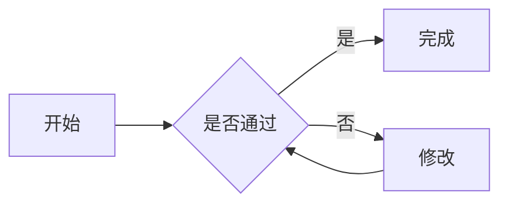
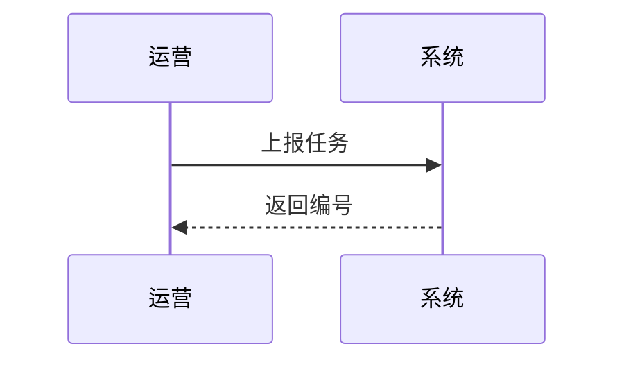
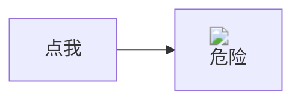

# 流程与换行

一行一条的写法（Typora、Obsidian 常见），中间没有空行。

## 流程图

## 采集点信息

名称：东区仓库
地址：清源路 55 号
负责人：王五
状态：采集中

## 可能的问题

1. 设备无法联网
  处理方式：重启后再试
2. 数据上传失败
  处理方式：等其他文件传完再点重试

## 手动换行

第一行\
第二行

## 时序图

## 安全

